I'm based in Florida. I like taking an idea about how a network could work and building it to see what happens. Lately, that means finding out what else DNS can carry.

## Start here

- [**Hydrascale**](https://github.com/Crank-Git/Hydrascale) <br>Runs multiple Tailscale tailnets at once on one Linux machine, with each in its own network namespace.
- [**Stratum**](https://github.com/stratum-hq/Stratum) <br>Drop-in multi-tenancy for Node.js, with tenant hierarchy, config inheritance, permissions, audit, and GDPR in one library.
- [**ja4plus-go**](https://github.com/Crank-Git/ja4plus-go) <br>Independent Go library and CLI for JA4+ network fingerprinting.
- [**ja4plus**](https://github.com/Crank-Git/ja4plus) <br>The same idea in Python, as a library and CLI.

## Things over port 53

DNS is often the last protocol a network lets out, so I keep seeing what fits through it.

```console
$ dig @127.0.0.1 -p 8053 +short TXT '2+3*4.calc.test'
"14"
```

| Project | What travels over DNS | Language |
|---|---|---|
| [**epochalypse**](https://github.com/Crank-Git/epochalypse) | Time capsules, dead man's switches, and countdowns, using DNSSEC and independent release agents | Go |
| [**mcport53**](https://github.com/Crank-Git/mcport53) | MCP tool calls, so an agent's tools work anywhere port 53 gets out | Go |
| [**wingman**](https://github.com/Crank-Git/wingman) | The WebRTC signaling handshake, then peers switch to a direct connection | Go |
| [**cachemoney**](https://github.com/Crank-Git/cachemoney) | Content-addressed git objects, packages, and blobs, with resolvers acting as the CDN | Go |
| [**llamaoverdns**](https://github.com/Crank-Git/llamaoverdns) | LLM answers in TXT records, with `dig` as the client | Python |
| [**dnscalc**](https://github.com/Crank-Git/dnscalc) | Math. The query is the expression, and the answer is the result | Go |

## Other packets

| Project | What it does | Language |
|---|---|---|
| [**sourceknock**](https://github.com/Crank-Git/sourceknock) | Port knocking through source ports instead of destination ports, for stealth rather than authentication | C |
| [**icmpchat**](https://github.com/Crank-Git/icmpchat) | Terminal chat inside ICMP echo requests, with optional AES-256-GCM encryption | Go |

## Off-grid and everything else

- [**ATAKMapDownloader**](https://github.com/Crank-Git/ATAKMapDownloader): downloads map tiles from 30+ sources and builds MBTiles databases for ATAK.
- [**MTFWBuilder**](https://github.com/Crank-Git/MTFWBuilder): a self-hosted web app that builds Meshtastic firmware with your config already in it.
- [**issue-flow-codex**](https://github.com/Crank-Git/issue-flow-codex): a Codex CLI port of the issue-flow plugin.
- [**simpletetris**](https://github.com/Crank-Git/simpletetris) and [**simplebubblebobble**](https://github.com/Crank-Git/simplebubblebobble): ad-free games for iPhone Safari.
